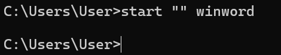

Laporan Praktikum: [Judul Praktikum]

1. Tujuan Praktikum

2. Pembahasan Praktikum, Latihan, dan Tugas

A. Pembahasan Praktikum

1. Cek task manager

Pembahasan :
Ini pembahasan

2. Jalankan salah satu aplikasi, perlihatkan proses yang dimunculkan oleh aplikasi
tersebut.

3. Carilah petunjuk untuk: me-restart proses dan mematikan proses. Matikan proses
yang dimunculkan oleh aplikasi yang anda jalankan, jangan gunakan perintah untuk
keluar dari aplikasi yang anda jalankan tetapi gunakan perintah untuk mematikan
proses dari aplikasi yang anda jalankan.

Merestart aplikasi

B. Latihan

C. Tugas

3. Kesimpulan
