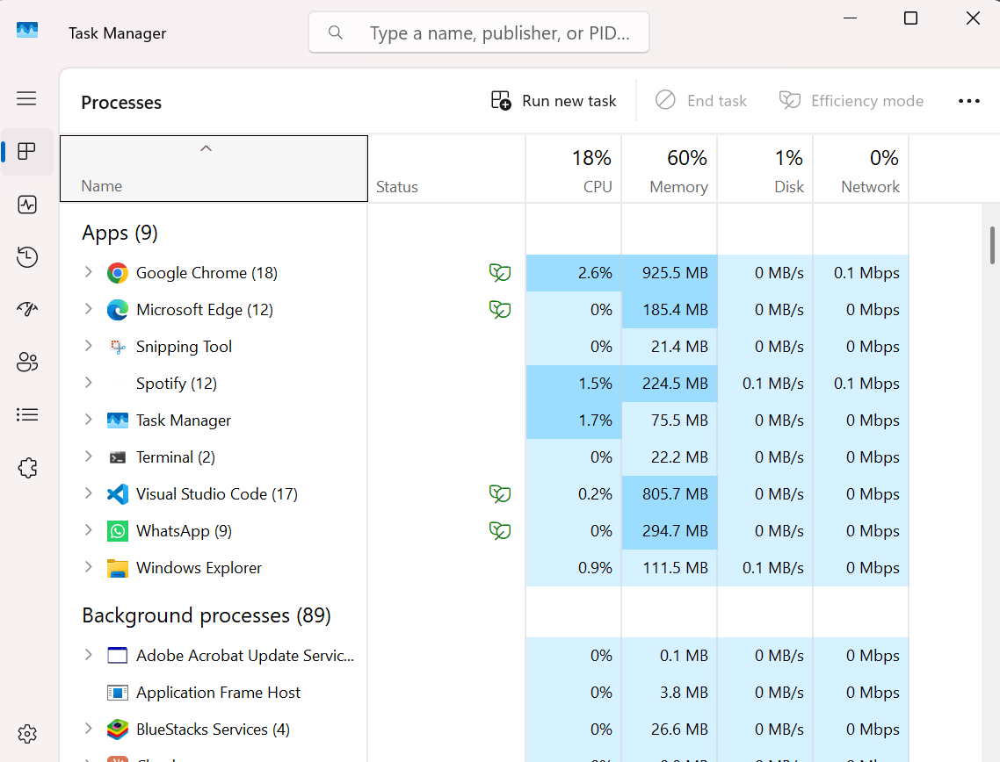
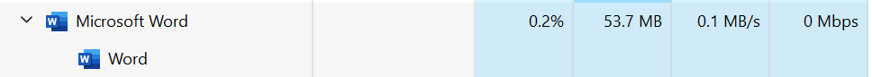

Laporan Praktikum: [Judul Praktikum]

1. Tujuan Praktikum

2. Pembahasan Praktikum, Latihan, dan Tugas

A. Pembahasan Praktikum

1. Cek task manager

Pembahasan :
Ini pembahasan

2. Jalankan salah satu aplikasi, perlihatkan proses yang dimunculkan oleh aplikasi
tersebut.

3. 
B. Latihan

C. Tugas

3. Kesimpulan
